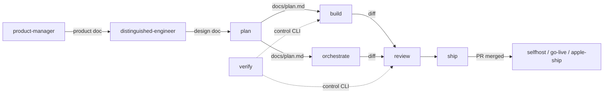

# devstack

devstack makes Claude Code work like a careful senior engineer: think before building,
change only what you asked for, prove it works.

Resume help is in [jobstack](../jobstack/); logos and app icons are in
[designstack](../designstack/).

## The rules (always on)

[rules/RULES.md](rules/RULES.md) is loaded into every session (and after `/clear` or
compaction) by a `SessionStart` hook, and into every subagent by a `SubagentStart` hook:

1. **Restate the goal** and the smallest change that meets it.
2. **Turn the goal into a check**; done means the check passed.
3. **Touch only what the request needs**; every changed line traces to it.
4. **Write the least code that works**; reuse before adding, ask before a new dependency.
5. **Agree before building** anything bigger than a small fix.
6. **Root cause before a fix**; after two failed fixes, test the assumption.
7. **Prove it**: show the command and output; label claims verified, inferred or guess.
8. **Be brief and plain**; use tables and diagrams where they read faster.
9. **Ask before anything hard to undo or outward-facing.**
10. **Hand wide work to subagents**, and check what they return.

Your own instructions always win over these.

## Skills



On the side: `debug`, `challenge`, `explain`, `code-trace` (thinking), `lean`, `scaffold`
(building), and `transcripts-to-skills` (improving the skills themselves).

### Thinking

| Skill | What it does |
|---|---|
| `product-manager` | Frames the product (who, why, core jobs, premises to agree or reject), works through topics one at a time with a decision log, writes the product doc. No code. |
| `distinguished-engineer` | Technical design: data shape first, a minimal and a fuller approach for each big decision, guardrails for LLM agents, and a parallel build plan. Stops for your pick. |
| `plan` | Writes `docs/plan.md`: goal, "done when" check, non-goals, steps that each name what they serve and how they're checked. Stops for a yes. |
| `debug` | Reproduce, find where it first goes wrong, failing test, one fix, proof. Stops after repeated failed fixes to question the assumption. |
| `challenge` | Read-only attempt to break a plan or diff. Keeps only findings proven by a run or specific lines. Changes nothing. |
| `explain` | Teaches a codebase or concept briefly, grounded in the code, with analogies to languages you know; answers "why is it like this?" from commits and PRs. |
| `code-trace` | Follows one real input through the code: numbered calls with `file:line`, a toy value at each step, database touches, failure cases; rendered as an HTML page. |

### Building

| Skill | What it does |
|---|---|
| `verify` | Sets up a control CLI (reusing the app's own) and a Feature Map so agents can drive the real app (backend, CLI, web, iOS/watchOS/tvOS, Android) and prove changes work; keeps both current. |
| `build` | Carries out the approved plan one step at a time: change, run the step's check, tick it off. Stops when the work would go beyond the plan. |
| `orchestrate` | Runs a big plan as one foundation step plus parallel agents in git worktrees, then merges in dependency order and passes an end-to-end smoke test. |
| `lean` | Makes a codebase small enough for one developer to read: measures lines, deletes unused code and fakes, uses the framework's own pieces, one test per behaviour, one-line comments, file-by-file trimming sessions. |
| `scaffold` | Bootstraps a small Next.js web app with the house stack (below) and a private repo. |

### Shipping

| Skill | What it does |
|---|---|
| `review` | Trace table (every changed file → the part of the request it serves; reverts what serves none), the "done when" check, the repo's own checks, secrets and dependency checks. |
| `ship` | Runs `review`, commits only what the change needs, pushes a branch, opens a PR that says why, what and how it was checked. Never merges. |
| `selfhost` | Step-by-step VPS setup: SSH keys, ufw, Cloudflare DNS, Caddy, systemd. You run every server command. |
| `go-live` | First production deploy: a deploy kit where the server pulls CI releases with checksum, health check and rollback; web on the same host; a step-by-step walkthrough. |
| `apple-ship` | iPhone, iPad, Watch, TV and Mac apps onto devices and TestFlight: account, signing, bundle IDs, Sign in with Apple, a configurable upload script for repeat releases, and fixes for common failures. |

### Improving

| Skill | What it does |
|---|---|
| `transcripts-to-skills` | Reads your past Claude Code sessions (only what's new since last run), finds repeated workflows and corrections, and turns them into skills in a PR. |

## The house web stack (`scaffold`)

Only `scaffold` and the stack checks in `review` and `ship` assume this:

- TypeScript, Next.js (App Router), plain CSS. No Tailwind, shadcn or animations.
  Server components first, minimal client JS.
- One container: Node 24 slim image, `next build` with `output: "standalone"`, SQLite
  via the built-in `node:sqlite` on a mounted volume, background jobs started from
  `instrumentation.ts`.
- Railway (or any Docker host), deployed from GitHub Actions.

## Install

```
/plugin marketplace add utkinnyc/ustack
/plugin install devstack@ustack
```

**Requirements:** [Claude Code](https://claude.com/claude-code), `git`, and the `gh` CLI
signed in. `scaffold` also needs Node 24 and Docker; its deploy workflow needs a
`RAILWAY_TOKEN` repo secret. `apple-ship` needs Xcode.

The rules come with the plugin: disabling devstack in `/plugin` turns them off along with
its skills.
